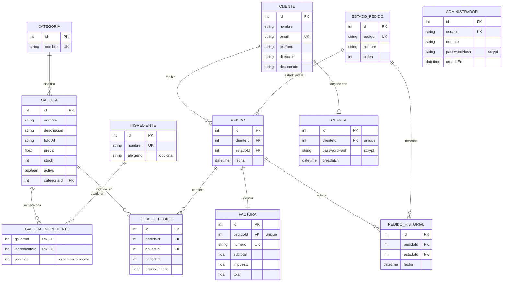
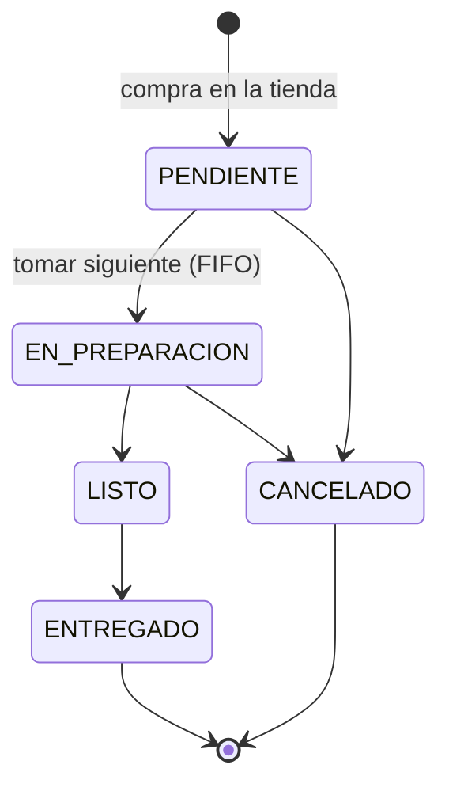

# Tienda de Galletas — demo académica (BD + normalización)

Demo completamente funcional de una tienda de galletas: inventario con foto/precio/stock,
clientes, compra con factura y una **cola de pedidos** para atenderlos en orden de llegada.
El objetivo académico es el **diseño de base de datos normalizado (3FN)**, implementado con
Prisma sobre SQLite.

## Dos caras

Una sola app con dos experiencias, cada una con su propio layout y navegación:

| Cara | Ruta | Para quién | Qué incluye |
|---|---|---|---|
| **Tienda** | `/` | Clientes | Catálogo con filtro y búsqueda, carrito, checkout, factura imprimible y seguimiento del pedido en vivo |
| **Administración** | `/admin` | Operación | Resumen, cola de pedidos, inventario, categorías, clientes, pedidos/facturas e **historial de pedidos** |

> Es una demo académica. Los clientes pueden comprar como invitados o crear una cuenta, y el
> panel `/admin` exige sesión de administrador (ver [Acceso y cuentas](#acceso-y-cuentas)).

## Stack

- **Backend**: Node.js + Express + Prisma ORM + SQLite (`backend/`)
- **Frontend**: Vite + React + Ant Design con tema rosa pastel (acento frambuesa, fuente Nunito local; los colores viven en `frontend/src/theme.js`) (`frontend/`)
- **Sesiones**: token firmado con HMAC-SHA256 en cookie `HttpOnly`; contraseñas con `scrypt`

## Acceso y cuentas

Hay dos tipos de sesión, independientes entre sí:

| Sesión | Dónde | Cookie | Duración | Cómo se obtiene |
|---|---|---|---|---|
| Cliente | `/ingresar` · `/registro` | `sesion_cliente` | 7 días | Registro propio (correo + contraseña) |
| Administrador | `/admin/login` | `sesion_admin` | 8 horas | Solo con un administrador creado por script |

- **Comprar como invitado sigue funcionando**: la cuenta es opcional. En `/ingresar` y
  `/registro` hay un enlace *Continuar como invitado*.
- Con sesión de cliente, el checkout aparece **pre-rellenado** y el pedido se asocia siempre al
  cliente de la sesión (el correo enviado no puede desviar la compra a otra cuenta).
- Si un invitado intenta comprar con un correo que **ya tiene cuenta**, la tienda le pide
  ingresar en lugar de crear un pedido suelto.
- El menú de perfil de la tienda muestra *Ingresar* y *Crear cuenta* sin sesión, y *Mis compras*,
  *Mi perfil* y *Salir* con sesión.
- El panel `/admin` está protegido **en el backend**: todas las rutas de administración responden
  `401` sin cookie válida, aunque se abran por URL. El frontend redirige a `/admin/login`.
- No hay registro público de administradores ni recuperación de contraseña.

### Administrador de demo

El script crea o actualiza el administrador definido en `backend/.env` **sin borrar datos**:

```bash
npm run admin:crear   # lee ADMIN_USUARIO, ADMIN_PASSWORD y ADMIN_NOMBRE de backend/.env
```

Credenciales de la demo (definidas en `backend/.env.example`):

| Usuario | Contraseña |
|---|---|
| `demo` | `demo1234` |

> **Solo para demo.** Cambia `ADMIN_PASSWORD` y `SESSION_SECRET` antes de usar esto fuera de un
> entorno local.

### Limitaciones conocidas

- **No se verifica el correo electrónico**: al registrarse con un correo que ya se usó para
  comprar como invitado, la cuenta se vincula a ese cliente y **hereda su historial de compras**.
- No hay "olvidé mi contraseña", cambio de correo ni cierre de sesión en todos los dispositivos
  (los tokens no se guardan en la base de datos, así que no se pueden revocar uno a uno).


## Requisitos

- Node.js 18+ (probado con v25) y npm

## Puesta en marcha

```bash
npm run install:all   # dependencias de la raíz, backend y frontend
npm run env:init      # crea backend/.env a partir de backend/.env.example
npm run db:deploy     # aplica las migraciones (crea backend/prisma/dev.db)
npm run db:seed       # categorías, galletas de ejemplo y estados de pedido
npm run admin:crear   # administrador de demo según backend/.env (usuario demo)
npm run dev           # backend y frontend a la vez
```

- Tienda: http://localhost:5173
- Ingresar / crear cuenta: http://localhost:5173/ingresar · http://localhost:5173/registro
- Administración: http://localhost:5173/admin/login (usuario `demo` / `demo1234`)
- API: http://localhost:4001/api
- Inspeccionar la BD: `npm run db:studio` (Prisma Studio)
- Ya tienes datos y solo quieres cargar las descripciones e ingredientes: `npm run db:recetas`
  (no borra pedidos ni clientes; sobrescribe la descripción de las galletas de la demo).

> Si el puerto 4001 o 5173 está ocupado, cambia `PORT` en `backend/.env` y el destino del
> proxy `/api` en `frontend/vite.config.js` (o define `API_URL` al arrancar Vite).
> Para volver al estado inicial de la demo en cualquier momento: `npm run db:seed` (borra
> pedidos, clientes y galletas, y las vuelve a crear).

## Estructura

```
tienda-galletas/
  backend/
    prisma/schema.prisma      modelo de datos (la lección de normalización)
    prisma/migrations/        SQL versionado de cada cambio del modelo
    prisma/seed.js            datos de ejemplo
    prisma/recetas.js         descripción e ingredientes de cada galleta (los usa el seed y `db:recetas`)
    prisma/crear-admin.js     crea/actualiza el administrador de demo
    src/auth.js               scrypt, tokens firmados, cookies y middlewares
    src/routes/               auth, admin/auth, categorías, galletas, clientes y pedidos (+ cola)
  frontend/
    public/galletas/          fotos locales de cada galleta (JPG)
    src/context/              carrito, sesión de cliente y sesión de administrador
    src/layouts/              CustomerLayout (tienda) y AdminLayout (panel)
    src/pages/                catálogo, carrito, checkout, factura, ingresar, registro, mis compras, mi perfil
    src/pages/admin/          login, resumen, cola, inventario, categorías, clientes, pedidos
  tools/generar-fotos/        render procedural de las fotos (`npm install` y `npm run fotos`; sin imágenes de terceros)
  CHANGELOG.md                historial de versiones
```

## Modelo de datos (3FN)



Decisiones de normalización (comentadas también en `backend/prisma/schema.prisma`):

- **Categoria** separada de **Galleta**: evita repetir el nombre de la categoría como texto
  libre en cada galleta (elimina una dependencia transitiva → 3FN).
- **Ingrediente** + **GalletaIngrediente** (N:M): "de qué está hecha" no es un texto con comas
  dentro de la galleta (atributo multivalor, rompe la 1FN y repite el mismo texto en muchas
  filas). Cada ingrediente se guarda una vez; la receta es la tabla asociativa, cuyo atributo
  `posicion` pertenece a la relación (el orden en esa galleta, de mayor a menor cantidad). El
  alérgeno es un valor simple del ingrediente, por eso no necesita tabla propia.
- **Cliente** separado de **Pedido**: los datos del cliente se capturan una sola vez y se
  reutilizan por `email` en compras futuras (evita duplicar nombre/dirección/teléfono).
- **DetallePedido** como entidad asociativa: resuelve la relación N:M entre Pedido y Galleta,
  y guarda `precioUnitario` como una "foto" del precio al momento de la venta — si la galleta
  cambia de precio después, las facturas históricas no se alteran.
- **Factura** separada de **Pedido** (relación 1:1): modela la diferencia real entre el
  documento comercial (pedido) y el documento fiscal (factura).
- **Pedido no guarda un total denormalizado**: el total vive únicamente en Factura, calculado
  a partir del detalle, para evitar datos derivados desincronizados.
- **EstadoPedido** como tabla de referencia: el estado deja de ser texto libre repetido en cada
  pedido (un typo ya no puede inventar un estado; renombrarlo es un solo `UPDATE`).
- **PedidoHistorial** como bitácora 1:N: el estado actual vive en `Pedido` y cada transición
  queda registrada sin perder el pasado.
- **Cuenta separada de Cliente** (1:1 opcional): las credenciales no pertenecen al perfil ni a la
  compra. Un invitado tiene `Cliente` pero no `Cuenta`; el email se guarda una sola vez (en
  `clientes`) y la cuenta solo referencia `clienteId`.
- **Administrador es una tabla aparte**: no comparte identidad ni ciclo de vida con los clientes,
  así un cliente nunca puede escalar a administrador. El hash de contraseña (`scrypt`) vive en
  `cuentas`/`administradores`, nunca en `clientes`.
- **La posición en la cola no se guarda**: se deduce de `fecha` (FIFO entre los pendientes),
  así no hay una columna extra que mantener sincronizada.

## Cola de pedidos

Cada compra entra a la cola como **PENDIENTE** y se atiende en orden de llegada (FIFO).



- **Tablero** en `/admin/cola`: columnas *En cola*, *En preparación* y *Listos para entregar*;
  el botón **Tomar siguiente** pasa a preparación el pedido más antiguo. Se actualiza solo
  cada 5 s, así que los pedidos nuevos de la tienda aparecen sin recargar.
- **Cancelar** (solo antes de que el pedido esté listo) devuelve el stock de sus galletas, una
  única vez.
- Si dos operadores toman pedidos a la vez, cada uno recibe uno distinto (cambio de estado con
  *compare-and-swap* dentro de una transacción).
- El **cliente** ve en su factura los pasos Recibido → Preparando → Listo → Entregado y cuántos
  pedidos hay antes que el suyo; se actualiza en vivo. La administración ve el historial de
  estados de cada pedido.

## API REST

Rutas marcadas con 🔒 exigen sesión: **cliente** para `/api/auth/*` de perfil y compras,
**administrador** para todo el panel. Sin cookie válida responden `401`.

| Método | Ruta | Descripción |
|---|---|---|
| POST | `/api/auth/registro` | Crea la cuenta del cliente (correo + contraseña ≥ 8) e inicia sesión |
| POST | `/api/auth/ingresar` | Inicia sesión de cliente |
| POST | `/api/auth/salir` | Cierra la sesión de cliente |
| GET | `/api/auth/me` | Cliente de la sesión o `{ "cliente": null }` (siempre 200) |
| PUT 🔒 | `/api/auth/perfil` | Actualiza nombre, teléfono, dirección y documento |
| GET 🔒 | `/api/auth/compras` | Pedidos del cliente de la sesión |
| POST | `/api/admin/auth/login` | Inicia sesión de administrador |
| POST | `/api/admin/auth/logout` | Cierra la sesión de administrador |
| GET | `/api/admin/auth/me` | Administrador de la sesión o `{ "admin": null }` |
| GET | `/api/categorias` · `/api/categorias/:id` | Listar categorías (público) |
| POST · PUT · DELETE 🔒 | `/api/categorias` · `/api/categorias/:id` | CRUD de categorías |
| GET | `/api/galletas` · `/api/galletas/:id` | Listar galletas (`?activa=true` para el catálogo) con su receta: `ingredientes` en orden y `alergenos` |
| POST · PUT · DELETE 🔒 | `/api/galletas` · `/api/galletas/:id` | CRUD de galletas; `ingredientes` (lista de nombres, en orden) reemplaza la receta y crea los ingredientes nuevos |
| GET | `/api/ingredientes` | Catálogo de ingredientes (para sugerirlos al editar una galleta) |
| GET · POST · PUT 🔒 | `/api/clientes` · `/api/clientes/:id` | Listar, crear/reutilizar por email, editar |
| GET 🔒 | `/api/pedidos` | Todos los pedidos con su estado |
| POST | `/api/pedidos` | Compra transaccional: valida stock, reutiliza cliente, crea pedido PENDIENTE, descuenta stock y emite factura |
| GET | `/api/pedidos/:id` | Detalle, factura, historial y `posicionCola` |
| GET 🔒 | `/api/pedidos/cola` | Pedidos activos en orden de llegada |
| GET 🔒 | `/api/pedidos/historial` | Historial paginado con detalle y bitácora de estados. Filtros: `estado` (lista separada por comas), `desde`/`hasta` (ISO), `q` (cliente, correo o N° de factura), `page`, `pageSize` (máx. 50) y `orden` (`asc`/`desc`). Devuelve además un `resumen` del conjunto filtrado (pedidos, ventas, entregados, cancelados, en curso y ticket promedio) |
| POST 🔒 | `/api/pedidos/cola/siguiente` | Toma el pedido PENDIENTE más antiguo |
| PATCH 🔒 | `/api/pedidos/:id/estado` | Cambia el estado (`{ "estado": "LISTO" }`) respetando el flujo |
| GET | `/api/health` | Salud del servicio |

## Flujo de ramas (GitFlow)

| Rama | Propósito |
|---|---|
| `main` | Producción: cada commit es una versión etiquetada (`vX.Y.Z`) |
| `develop` | Integración: aquí se unen las funcionalidades terminadas |
| `feature/*` | Una funcionalidad; sale de `develop` y vuelve con merge `--no-ff` |
| `release/X.Y.Z` | Preparación de versión (número y CHANGELOG); se une a `main` y `develop` y se etiqueta |
| `hotfix/X.Y.Z` | Corrección urgente sobre `main`; se une a `main` y `develop` y se etiqueta |

Versiones publicadas (ver [CHANGELOG.md](CHANGELOG.md)):

| Versión | Contenido |
|---|---|
| `v1.0.0` | Demo base: modelo normalizado, API, tienda y panel de administración |
| `v1.0.1` | Hotfix: el backend ya no se cae por errores de Prisma sin capturar |
| `v1.1.0` | Dos caras (tienda y administración), clientes, fotos locales |
| `v1.2.0` | Cola de pedidos con estados, historial y seguimiento del cliente |
| `v1.3.0` | Cuentas de cliente, compra como invitado, login de administrador y rutas protegidas |

Con [git-flow (AVH)](https://github.com/petervanderdoes/gitflow-avh) instalado, el repositorio se
prepara con `git config gitflow.branch.master main && git flow init -d` y se usa así:

```bash
git flow feature start mi-cambio      # ... commits ...
git flow feature finish mi-cambio
git flow release start 1.3.0          # sube versión y CHANGELOG
git flow release finish 1.3.0         # merge a main + tag v1.3.0 + merge a develop
git flow hotfix start 1.2.1
git flow hotfix finish 1.2.1
```

Los mensajes de commit siguen *Conventional Commits* (`feat:`, `fix:`, `docs:`, `chore:`).

## Flujo de prueba manual

1. Abre la tienda, filtra por categoría, agrega 2-3 galletas al carrito y confirma la compra con
   un correo nuevo: obtienes la factura (IVA 19%) y el seguimiento del pedido.
2. Entra a `/admin/login`, inicia sesión con `demo` / `demo1234`. En `/admin/cola` toma el
   siguiente pedido, márcalo listo y entrégalo; mientras tanto la factura del cliente avanza sola.
   Cancela otro y comprueba en **Inventario** que el stock volvió.
3. Repite una compra con el **mismo correo**: en **Clientes** ves un único cliente con sus dos
   pedidos (sin duplicarlo).
4. Crea una cuenta en `/registro` con un correo nuevo: el menú de perfil muestra *Mis compras*,
   *Mi perfil* y *Salir*, y el checkout llega pre-rellenado. En *Mis compras* aparecen los pedidos
   hechos con esa cuenta.
5. Cierra sesión, compra como invitado con el correo de una cuenta existente: la tienda pide
   ingresar (`CUENTA_EXISTE`) en lugar de crear el pedido.
6. Abre `/admin` sin sesión o tras *Salir*: redirige a `/admin/login`. Prueba también
   `curl http://localhost:4001/api/clientes`: responde `401`.
7. Edita el precio de una galleta en **Inventario**: el catálogo cambia, pero las facturas ya
   emitidas conservan el `precioUnitario` histórico.
8. En **Historial de pedidos** filtra por estado, fechas o texto, y despliega un pedido para ver
   sus productos y cuándo pasó por cada estado (el resumen de arriba sigue los filtros).
9. Reinicia el backend: los datos persisten en `backend/prisma/dev.db`.

## Fuera de alcance (a propósito, para mantener el ejercicio pequeño)

Verificación de correo, recuperación de contraseña, roles granulares, pagos reales, envío de
emails, generación de PDF real (se usa la impresión del navegador), subida de archivos de imagen
(se usa URL o las ilustraciones locales), despliegue en la nube y tests automatizados.
