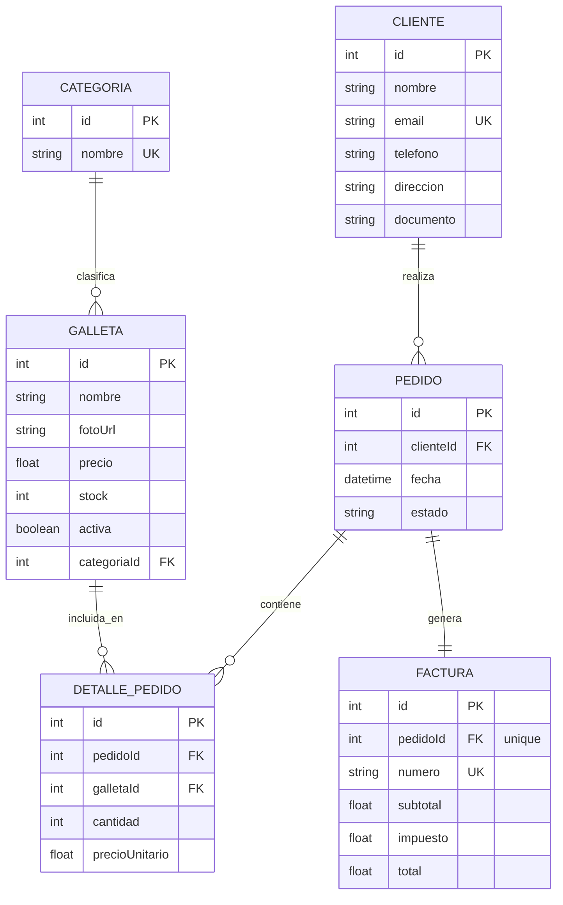

# Tienda de Galletas — demo académica (BD + normalización)

Demo completamente funcional de una tienda de galletas: inventario con foto/precio/stock,
clientes, simulación de compra y factura. El objetivo académico es el **diseño de base de
datos normalizado (3FN)**, implementado con Prisma sobre SQLite.

## Stack

- **Backend**: Node.js + Express + Prisma ORM + SQLite (`backend/`)
- **Frontend**: Vite + React + Ant Design, paleta monocromática estilo Google Chrome (`frontend/`)

## Requisitos

- Node.js 18+ (probado con v25) y npm

## Puesta en marcha

```bash
npm run install:all   # dependencias de la raíz, backend y frontend
npm run env:init      # crea backend/.env a partir de backend/.env.example
npm run db:deploy     # aplica las migraciones (crea backend/prisma/dev.db)
npm run db:seed       # categorías y galletas de ejemplo
npm run dev           # backend y frontend a la vez
```

- Frontend: http://localhost:5173
- API backend: http://localhost:4001/api
- Inspeccionar la BD visualmente: `npm run db:studio` (Prisma Studio)

> Si el puerto 4001 o 5173 está ocupado en tu máquina, cámbialo en `backend/.env`
> (`PORT`) y en `frontend/vite.config.js` (`server.port` y el proxy `/api`).

## Modelo de datos (3FN)



Decisiones de normalización (ver también los comentarios en `backend/prisma/schema.prisma`):

- **Categoria** separada de **Galleta**: evita repetir el nombre de la categoría como texto
  libre en cada galleta (elimina una dependencia transitiva → 3FN).
- **Cliente** separado de **Pedido**: los datos del cliente se capturan una sola vez y se
  reutilizan por `email` en compras futuras (evita duplicar nombre/dirección/teléfono).
- **DetallePedido** como entidad asociativa: resuelve la relación N:M entre Pedido y Galleta,
  y guarda `precioUnitario` como una "foto" del precio al momento de la venta — si la galleta
  cambia de precio después, las facturas históricas no se alteran.
- **Factura** separada de **Pedido** (relación 1:1): modela la diferencia real entre el
  documento comercial (pedido) y el documento fiscal (factura).
- **Pedido no guarda un total denormalizado**: el total vive únicamente en Factura, calculado
  a partir del detalle, para evitar datos derivados desincronizados.

## Flujo de ramas (GitFlow)

| Rama | Propósito |
|---|---|
| `main` | Producción: cada commit es una versión etiquetada (`vX.Y.Z`) |
| `develop` | Integración: aquí se unen las funcionalidades terminadas |
| `feature/*` | Una funcionalidad; sale de `develop` y vuelve con merge `--no-ff` |
| `release/X.Y.Z` | Preparación de versión (número y CHANGELOG); se une a `main` y `develop` y se etiqueta |
| `hotfix/X.Y.Z` | Corrección urgente sobre `main`; se une a `main` y `develop` y se etiqueta |

Los mensajes de commit siguen *Conventional Commits* (`feat:`, `fix:`, `docs:`, `chore:`). El
historial de versiones está en [CHANGELOG.md](CHANGELOG.md).

## Flujo de prueba manual

1. Abre `http://localhost:5173`, revisa el catálogo (10 galletas sembradas).
2. Agrega 2-3 galletas al carrito variando cantidades, ve a **Carrito** → **Ir a pagar**.
3. Completa el formulario de checkout con un correo nuevo y confirma la compra.
4. Verifica la factura generada (totales, IVA 19%) y prueba **Imprimir / Guardar PDF**.
5. Ve a **Administración → Inventario**: el stock de las galletas compradas debe verse reducido.
6. Repite una compra usando el **mismo correo**: en **Administración → Pedidos** debes ver
   ambos pedidos asociados al mismo cliente (sin duplicarlo — puedes confirmarlo con
   `npm run db:studio`, tabla `clientes`).
7. Edita el precio de una galleta desde **Inventario**: el catálogo debe reflejar el nuevo
   precio, pero las facturas ya emitidas deben conservar el `precioUnitario` histórico.
8. Reinicia el backend: los datos persisten en `backend/prisma/dev.db`.

Para reiniciar la demo a su estado inicial en cualquier momento: `npm run db:seed`.

## Fuera de alcance (a propósito, para mantener el ejercicio pequeño)

Autenticación/roles, pagos reales, envío de emails, generación de PDF real (se usa la impresión
del navegador), subida de archivos de imagen (se usa URL), despliegue en la nube y tests
automatizados.
