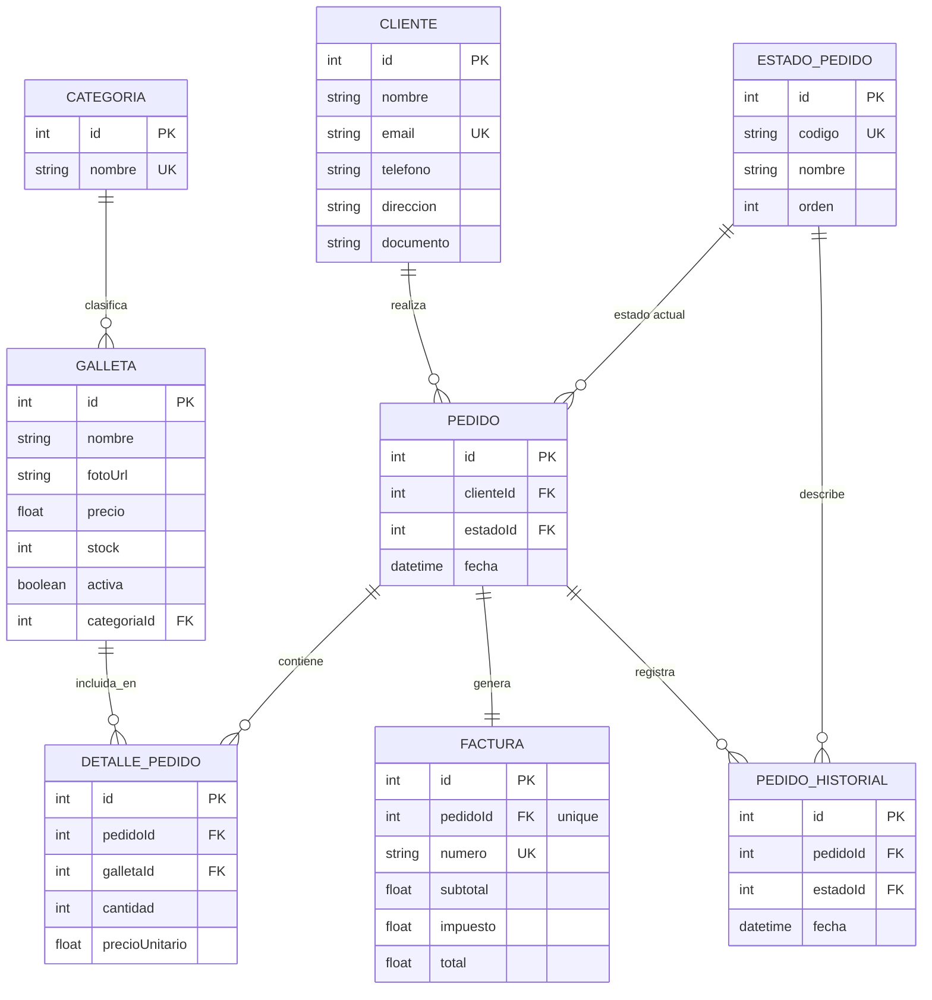
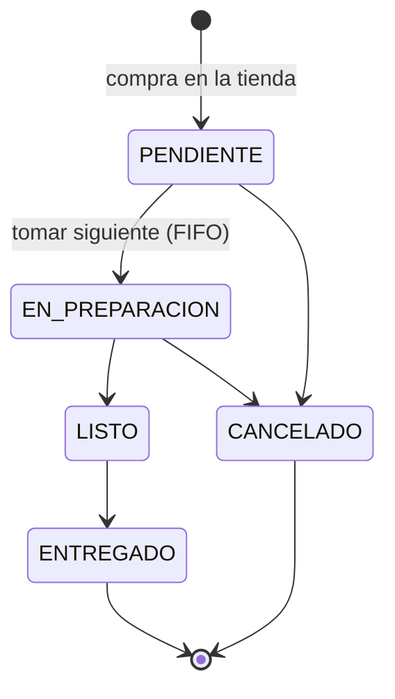

# Tienda de Galletas — demo académica (BD + normalización)

Demo completamente funcional de una tienda de galletas: inventario con foto/precio/stock,
clientes, compra con factura y una **cola de pedidos** para atenderlos en orden de llegada.
El objetivo académico es el **diseño de base de datos normalizado (3FN)**, implementado con
Prisma sobre SQLite.

## Dos caras

Una sola app con dos experiencias, cada una con su propio layout y navegación:

| Cara | Ruta | Para quién | Qué incluye |
|---|---|---|---|
| **Tienda** | `/` | Clientes | Catálogo con filtro y búsqueda, carrito, checkout, factura imprimible y seguimiento del pedido en vivo |
| **Administración** | `/admin` | Operación | Resumen, cola de pedidos, inventario, categorías, clientes y pedidos/facturas |

> Es una demo académica: **no hay login**, el panel `/admin` es accesible por URL.

## Stack

- **Backend**: Node.js + Express + Prisma ORM + SQLite (`backend/`)
- **Frontend**: Vite + React + Ant Design, paleta monocromática estilo Google Chrome (`frontend/`)

## Requisitos

- Node.js 18+ (probado con v25) y npm

## Puesta en marcha

```bash
npm run install:all   # dependencias de la raíz, backend y frontend
npm run env:init      # crea backend/.env a partir de backend/.env.example
npm run db:deploy     # aplica las migraciones (crea backend/prisma/dev.db)
npm run db:seed       # categorías, galletas de ejemplo y estados de pedido
npm run dev           # backend y frontend a la vez
```

- Tienda: http://localhost:5173
- Administración: http://localhost:5173/admin
- API: http://localhost:4001/api
- Inspeccionar la BD: `npm run db:studio` (Prisma Studio)

> Si el puerto 4001 o 5173 está ocupado, cambia `PORT` en `backend/.env` y el destino del
> proxy `/api` en `frontend/vite.config.js` (o define `API_URL` al arrancar Vite).
> Para volver al estado inicial de la demo en cualquier momento: `npm run db:seed` (borra
> pedidos, clientes y galletas, y las vuelve a crear).

## Estructura

```
tienda-galletas/
  backend/
    prisma/schema.prisma      modelo de datos (la lección de normalización)
    prisma/migrations/        SQL versionado de cada cambio del modelo
    prisma/seed.js            datos de ejemplo
    src/routes/               categorías, galletas, clientes y pedidos (+ cola)
  frontend/
    public/galletas/          ilustraciones locales de cada galleta
    src/layouts/              CustomerLayout (tienda) y AdminLayout (panel)
    src/pages/                catálogo, carrito, checkout, factura
    src/pages/admin/          resumen, cola, inventario, categorías, clientes, pedidos
  CHANGELOG.md                historial de versiones
```

## Modelo de datos (3FN)



Decisiones de normalización (comentadas también en `backend/prisma/schema.prisma`):

- **Categoria** separada de **Galleta**: evita repetir el nombre de la categoría como texto
  libre en cada galleta (elimina una dependencia transitiva → 3FN).
- **Cliente** separado de **Pedido**: los datos del cliente se capturan una sola vez y se
  reutilizan por `email` en compras futuras (evita duplicar nombre/dirección/teléfono).
- **DetallePedido** como entidad asociativa: resuelve la relación N:M entre Pedido y Galleta,
  y guarda `precioUnitario` como una "foto" del precio al momento de la venta — si la galleta
  cambia de precio después, las facturas históricas no se alteran.
- **Factura** separada de **Pedido** (relación 1:1): modela la diferencia real entre el
  documento comercial (pedido) y el documento fiscal (factura).
- **Pedido no guarda un total denormalizado**: el total vive únicamente en Factura, calculado
  a partir del detalle, para evitar datos derivados desincronizados.
- **EstadoPedido** como tabla de referencia: el estado deja de ser texto libre repetido en cada
  pedido (un typo ya no puede inventar un estado; renombrarlo es un solo `UPDATE`).
- **PedidoHistorial** como bitácora 1:N: el estado actual vive en `Pedido` y cada transición
  queda registrada sin perder el pasado.
- **La posición en la cola no se guarda**: se deduce de `fecha` (FIFO entre los pendientes),
  así no hay una columna extra que mantener sincronizada.

## Cola de pedidos

Cada compra entra a la cola como **PENDIENTE** y se atiende en orden de llegada (FIFO).



- **Tablero** en `/admin/cola`: columnas *En cola*, *En preparación* y *Listos para entregar*;
  el botón **Tomar siguiente** pasa a preparación el pedido más antiguo. Se actualiza solo
  cada 5 s, así que los pedidos nuevos de la tienda aparecen sin recargar.
- **Cancelar** (solo antes de que el pedido esté listo) devuelve el stock de sus galletas, una
  única vez.
- Si dos operadores toman pedidos a la vez, cada uno recibe uno distinto (cambio de estado con
  *compare-and-swap* dentro de una transacción).
- El **cliente** ve en su factura los pasos Recibido → Preparando → Listo → Entregado y cuántos
  pedidos hay antes que el suyo; se actualiza en vivo. La administración ve el historial de
  estados de cada pedido.

## API REST

| Método | Ruta | Descripción |
|---|---|---|
| GET · POST · PUT · DELETE | `/api/categorias` · `/api/categorias/:id` | CRUD de categorías |
| GET · POST · PUT · DELETE | `/api/galletas` · `/api/galletas/:id` | CRUD de galletas (`?activa=true` para el catálogo) |
| GET · POST · PUT | `/api/clientes` · `/api/clientes/:id` | Listar, crear/reutilizar por email, editar |
| GET | `/api/pedidos` | Todos los pedidos con su estado |
| POST | `/api/pedidos` | Compra transaccional: valida stock, reutiliza cliente, crea pedido PENDIENTE, descuenta stock y emite factura |
| GET | `/api/pedidos/:id` | Detalle, factura, historial y `posicionCola` |
| GET | `/api/pedidos/cola` | Pedidos activos en orden de llegada |
| POST | `/api/pedidos/cola/siguiente` | Toma el pedido PENDIENTE más antiguo |
| PATCH | `/api/pedidos/:id/estado` | Cambia el estado (`{ "estado": "LISTO" }`) respetando el flujo |
| GET | `/api/health` | Salud del servicio |

## Flujo de ramas (GitFlow)

| Rama | Propósito |
|---|---|
| `main` | Producción: cada commit es una versión etiquetada (`vX.Y.Z`) |
| `develop` | Integración: aquí se unen las funcionalidades terminadas |
| `feature/*` | Una funcionalidad; sale de `develop` y vuelve con merge `--no-ff` |
| `release/X.Y.Z` | Preparación de versión (número y CHANGELOG); se une a `main` y `develop` y se etiqueta |
| `hotfix/X.Y.Z` | Corrección urgente sobre `main`; se une a `main` y `develop` y se etiqueta |

Versiones publicadas (ver [CHANGELOG.md](CHANGELOG.md)):

| Versión | Contenido |
|---|---|
| `v1.0.0` | Demo base: modelo normalizado, API, tienda y panel de administración |
| `v1.0.1` | Hotfix: el backend ya no se cae por errores de Prisma sin capturar |
| `v1.1.0` | Dos caras (tienda y administración), clientes, fotos locales |
| `v1.2.0` | Cola de pedidos con estados, historial y seguimiento del cliente |

Con [git-flow (AVH)](https://github.com/petervanderdoes/gitflow-avh) instalado, el repositorio se
prepara con `git config gitflow.branch.master main && git flow init -d` y se usa así:

```bash
git flow feature start mi-cambio      # ... commits ...
git flow feature finish mi-cambio
git flow release start 1.3.0          # sube versión y CHANGELOG
git flow release finish 1.3.0         # merge a main + tag v1.3.0 + merge a develop
git flow hotfix start 1.2.1
git flow hotfix finish 1.2.1
```

Los mensajes de commit siguen *Conventional Commits* (`feat:`, `fix:`, `docs:`, `chore:`).

## Flujo de prueba manual

1. Abre la tienda, filtra por categoría, agrega 2-3 galletas al carrito y confirma la compra con
   un correo nuevo: obtienes la factura (IVA 19%) y el seguimiento del pedido.
2. En `/admin/cola` toma el siguiente pedido, márcalo listo y entrégalo; mientras tanto la
   factura del cliente avanza sola. Cancela otro y comprueba en **Inventario** que el stock volvió.
3. Repite una compra con el **mismo correo**: en **Clientes** ves un único cliente con sus dos
   pedidos (sin duplicarlo).
4. Edita el precio de una galleta en **Inventario**: el catálogo cambia, pero las facturas ya
   emitidas conservan el `precioUnitario` histórico.
5. Reinicia el backend: los datos persisten en `backend/prisma/dev.db`.

## Fuera de alcance (a propósito, para mantener el ejercicio pequeño)

Autenticación/roles, pagos reales, envío de emails, generación de PDF real (se usa la impresión
del navegador), subida de archivos de imagen (se usa URL o las ilustraciones locales), despliegue
en la nube y tests automatizados.
